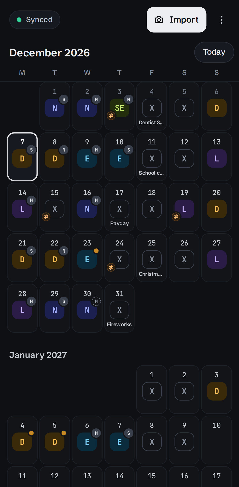
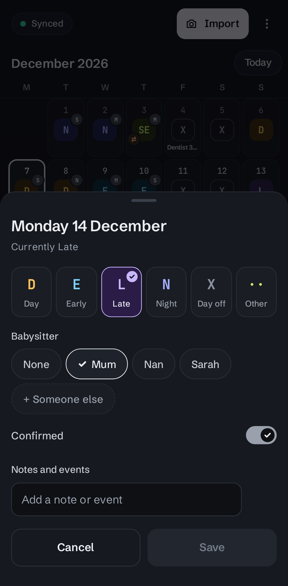
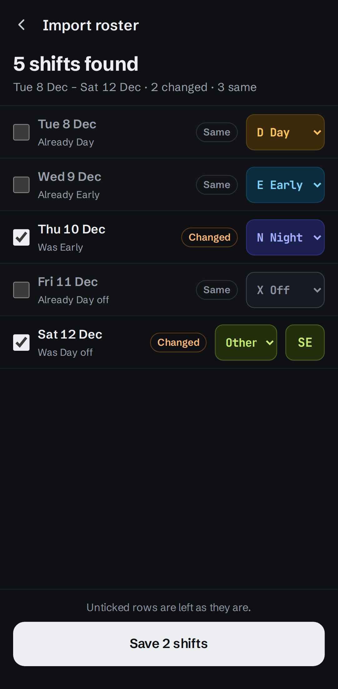
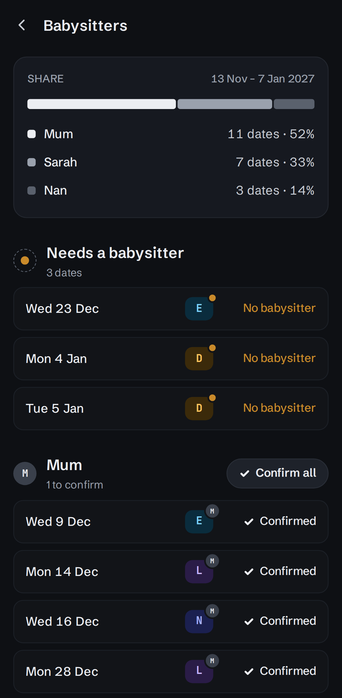

# Roster Mate

A small, self-hosted, **single-user** roster app for one shift worker's phone. Photograph a printed roster, Claude reads your shifts from it, you review them and save. It also tracks events and who's babysitting, and keeps working offline.

<table>
  <tr>
    <td></td>
    <td></td>
    <td></td>
    <td></td>
  </tr>
  <tr>
    <td align="center">Calendar</td>
    <td align="center">Date sheet</td>
    <td align="center">Import review</td>
    <td align="center">Babysitters</td>
  </tr>
</table>

## Deploy

Roster Mate is a single container, configured entirely through environment variables. It needs an Anthropic API key to read roster photos. Images for amd64 and arm64 are on the [GitHub packages page](https://github.com/simonpratt/roster-mate/pkgs/container/roster-mate).

The container runs as UID/GID 65532, so the volume mounted at `/data` must be owned by (or writable for) that user.

### Configuration

| Variable | Default | |
|---|---|---|
| `APP_USERNAME` | required | Login username |
| `APP_PASSWORD` | required | Login password |
| `ANTHROPIC_API_KEY` | required | Used to read roster photos. Stays on the server |
| `ROSTER_NAME` | required | Your name as printed on rosters, so Claude finds your row |
| `ANTHROPIC_MODEL` | `claude-sonnet-5-5` | Model used to read roster photos |
| `SESSION_SECRET` | generated | Key for session cookies. When empty, one is generated and kept in the database |
| `PORT` | `8080` | Port inside the container |
| `DATA_DIR` | `/data` | Holds `roster-mate.db` |
| `TZ` | UTC | Timezone for "today" when reading a roster |

The full list, including test-only settings, is in `docs/design.md`.

### Notes

- **HTTPS:** installing to the home screen and working offline need HTTPS, so put it behind a reverse proxy.
- **Proxy timeout:** reading a roster can take up to 90 seconds, so set the proxy's read timeout above that.
- **Offline:** the phone keeps its own copy of your shifts and syncs when it can reach the server.
